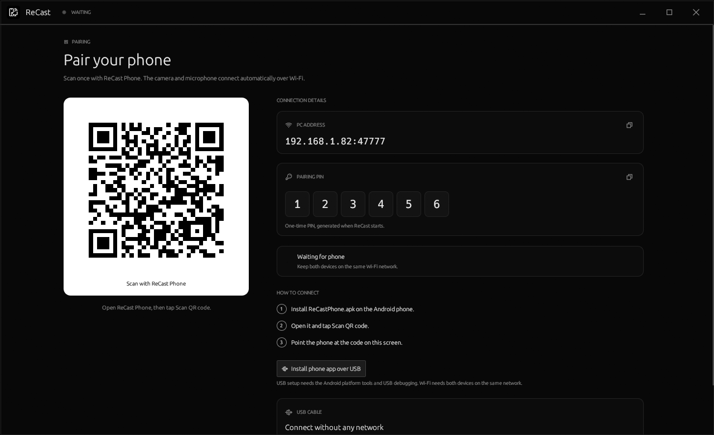
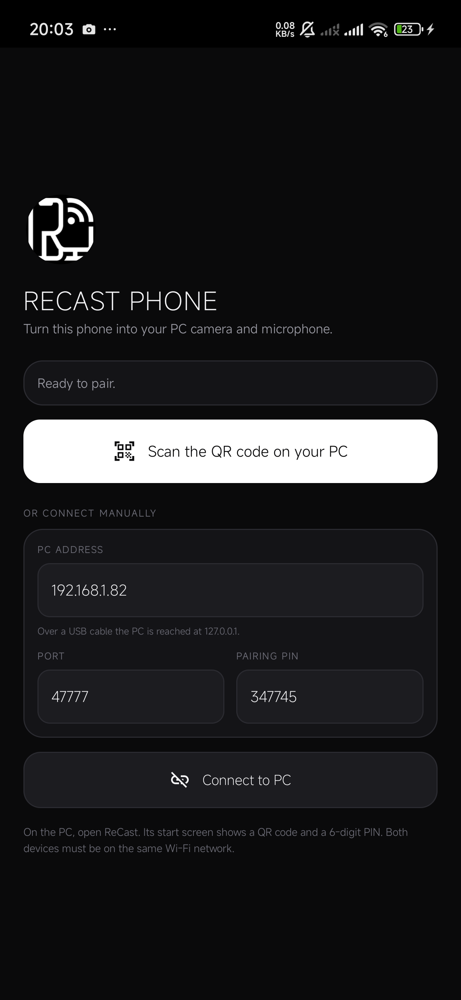
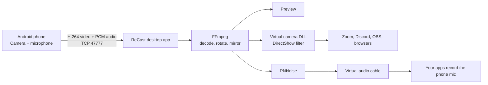

<div align="center">

# ReCast

**Use an Android phone as a webcam and microphone on Windows.**
No account, no ads, no telemetry, no cloud. Everything stays on your own cable or home network.

[](https://github.com/xxRelaXxx/ReCast/releases/latest)
[](LICENSE)
[](https://github.com/xxRelaXxx/ReCast)
[](https://github.com/xxRelaXxx/ReCast)

</div>

ReCast turns a spare phone into the only camera and microphone your PC needs. The phone
sends H.264 video and 48 kHz mono audio straight to the PC over **USB** or **Wi-Fi**. On the
PC, ReCast decodes the stream, shows a live preview and feeds the picture into a **virtual
camera** that every application on Windows can open, and the sound into a **virtual
microphone** through any virtual audio cable.

* One file to download: `desktop/ReCast.exe` installs and starts everything else.
* One file to sideload on the phone: `phone/ReCastPhone.apk`.
* Black and white interface, no settings maze, no sign-in.

---

## Screenshots

| Desktop app | Phone app |
| --- | --- |
|  |  |

*Both screenshots show the pairing screens. The PIN is the placeholder `123456`.*

---

## What you get

| | |
| --- | --- |
| **Virtual camera** | "ReCast Camera" appears in Windows, Zoom, Discord, OBS, Chrome, Edge, Teams and anything else that uses DirectShow or Media Foundation. 32-bit and 64-bit applications are both supported. |
| **Virtual microphone** | Phone audio is written to a virtual audio cable, so other applications can record it like a normal microphone. Cable detection is automatic. |
| **Camera control** | Switch between the front, back and additional phone cameras. Pick the resolution and frame rate the phone actually supports. |
| **Torch and zoom** | Turn the flashlight on or off and zoom from 1x to 8x, from either the PC or the phone. |
| **Rotation and mirror** | Add a quarter turn if a phone reports the wrong orientation, and mirror the preview for the selfie camera. |
| **Noise suppression** | RNNoise removes steady background noise from the microphone. Strength is adjustable, 80 % by default. |
| **Microphone gain** | A boost of 0 to 300 % makes the phone microphone louder or quieter for the applications that use it. |
| **Upright preview** | The phone preview is never stretched: it is rotated and cropped to fill its frame and follows the phone when you turn it. |
| **Minimal interface** | Monochrome, no settings maze. The camera and the microphone are switched on and off with one tap. |
| **QR pairing** | The desktop shows a QR code before anything else. Scan it with the built-in phone scanner and the app fills in the address and PIN, then connects. |

---

## Quick start

1. **Download** the latest release and unpack it. You get two folders:

   ```
   ReCast-1.0.0/
   ├── desktop/
   │   └── ReCast.exe      <- the whole desktop app in one file
   └── phone/
       └── ReCastPhone.apk <- the phone app
   ```

2. **Run `desktop/ReCast.exe`.** It unpacks itself into `%LOCALAPPDATA%\ReCast`, registers
   the virtual camera for your Windows user and starts the app. The first launch asks once
   for administrator approval to remove an old camera entry and to allow the app through
   Windows Firewall. Declining is fine: the virtual camera still works for your user and
   Windows asks about the network permission the first time the phone connects.

3. **Install `phone/ReCastPhone.apk`** on the phone. Allow "Install unknown apps" for your
   file manager if Android asks. The APK is debug-signed for easy sideloading and is not
   distributed through Google Play, so Play Protect may ask you to confirm.

4. **Connect the phone.** The desktop app opens on a pairing screen with a QR code.
   Open ReCast on the phone, tap **Scan the QR code** and point it at the screen. The
   app fills in the address and PIN and connects. Manual entry is still available under
   the code (Wi-Fi), or press **Connect over USB** in the desktop app (USB, needs `adb`).

5. **Pick the camera.** In the application you want to use, choose
   **ReCast Camera**. For sound, choose the capture side of your virtual audio
   cable, for example *Microphone (Voice.ai Audio Cable)*.

Full instructions, controls and troubleshooting are in the [user guide](docs/USER-GUIDE.md).

---

## Connecting the phone

### Wi-Fi

The desktop app opens on its pairing screen: a QR code and a 6-digit PIN. Open ReCast
on the phone and tap **Scan the QR code**. The code carries every local address of the
PC and the PIN, so the phone connects without typing anything.

If you prefer manual entry, tap the address field under the code, type the address
shown under the QR code (for example `192.168.1.20:47777`), enter the PIN and press
**Connect**. Keep the phone and the PC on the same network; guest Wi-Fi with client
isolation blocks the connection, so use USB or a phone hotspot in that case.

### USB (recommended, lower latency)

1. On the phone: *Settings > About phone > tap "Build number" seven times*, then
   *Settings > System > Developer options > enable "USB debugging"*.
2. Connect a **data** cable, choose "File transfer" if asked and accept "Allow USB
   debugging?" on the phone.
3. Install the Android platform-tools so that `adb.exe` is in `PATH` (or in
   `%LOCALAPPDATA%\Android\Sdk\platform-tools`).
4. press **Connect over USB** in ReCast. The app installs the APK, opens a reverse tunnel
   (`adb reverse tcp:47777`) and starts the phone app with the address and PIN already
   filled in.

### The pairing PIN

The PIN is generated fresh every time the desktop app starts and is embedded in the QR
code. It is only used to make sure that a phone on your network is really the phone you
asked for. Change it by restarting ReCast; there is no account and nothing is stored
anywhere else. The phone's scanner works completely offline and does not send the code
anywhere.

---

## How it works



* The phone encodes the camera with the hardware H.264 encoder and the microphone as
  16-bit PCM, and streams both over one TCP connection.
* The desktop app decodes the video with a **separate, minimal FFmpeg executable** that is
  bundled with ReCast, applies rotation and mirroring, and pushes the frames into the
  virtual camera filter.
* The virtual camera is a small DirectShow filter derived from the MIT-licensed
  [softcam](https://github.com/tshino/softcam) project. Its source is included in this
  repository under `tools/vcam/source`.
* Audio is filtered with [RNNoise](https://github.com/xiph/rnnoise) before it is written to
  the virtual audio cable.

More detail is in [docs/ARCHITECTURE.md](docs/ARCHITECTURE.md).

---

## Requirements

| | |
| --- | --- |
| PC | Windows 10 or 11, 64-bit |
| Phone | Android 9 (API 29) or newer, with a camera |
| Link | A USB data cable, or both devices on the same Wi-Fi network |
| Microphone output | A virtual audio cable such as *Voice.ai Audio Cable* or *VB-CABLE* (optional, only needed for the virtual microphone) |
| USB setup | Android platform-tools (`adb`), optional |

The desktop app is a single 12 MB executable and keeps a small working set; it does not
run a service in the background and stops completely when you close the window.

---

## Privacy

* Video and audio travel **directly** between the phone and the PC. Nothing is uploaded,
  nothing is recorded, nothing is analysed.
* No accounts, no advertisements, no analytics, no crash reporting, no network access other
  than the local stream.
* The local link is **not encrypted**. Use it on your own cable and your own network.
* ReCast only asks for administrator rights once, and only to remove an old camera entry
  and to add a firewall rule for TCP port 47777. Everything else runs as your user.

---

## The `recast` command

ReCast installs a small command line tool next to the app and adds it to your PATH, so
you can drive it from any terminal:

```console
$ recast                      # start the desktop app
$ recast status               # what is connected right now
$ recast pair                 # the address and PIN to type into the phone
$ recast usb                  # set up the phone over USB
$ recast set resolution 1920 1080 --fps 30
$ recast set camera 0         # or: recast set camera back
$ recast set mic off
$ recast set torch on
$ recast set zoom 2.5
$ recast rotate 90
$ recast theme graphite
$ recast doctor               # check the installation
$ recast uninstall            # remove the camera and the PATH entry
```

The command talks to the running app over a local, token-protected channel on the
loopback interface, so it never touches the network. `recast --help` lists every
subcommand.

If the command is not found, open a new terminal — the PATH is updated when ReCast is
installed for the first time. `recast install` adds it again at any time.

---

## Building from source

The repository contains everything needed to rebuild every part:

```text
apps/app         Rust desktop app (eframe/egui, cpal, nnnoiseless)
apps/cli         Rust command line tool (clap)
apps/core        Shared install, registry and control-channel logic
apps/launcher    Rust one-file launcher and installer
android/         Kotlin phone app
tools/ffmpeg     Minimal LGPL FFmpeg build used to decode the video
tools/vcam       Virtual camera filter (softcam fork) and its source
tools/           Build and release scripts
```

Short version:

```powershell
git clone git@github.com:xxRelaXxx/ReCast.git
cd ReCast
.\tools\build-release.ps1          # builds the app, the CLI, the APK and the launcher
```

The script needs a Rust toolchain, the Android SDK (API 34) and JDK 17. Detailed steps,
including how to rebuild the FFmpeg binary and the virtual camera DLL, are in
[docs/BUILDING.md](docs/BUILDING.md).

---

## Troubleshooting

| Symptom | Fix |
| --- | --- |
| The camera is not listed in another app | Pick *ReCast Camera* again, close and reopen the other app so it re-reads the device list, and make sure ReCast is running. |
| A website shows no picture | Allow **both** camera and microphone, choose *ReCast Camera* in the site, then reload the page. |
| The picture is sideways | Press **+90°** in the desktop app until it is upright, then **Reset** to return to the phone's own orientation. |
| The microphone is silent | Install a virtual audio cable, select its capture side, unmute *Phone microphone* and enable *Virtual microphone*. |
| The connection fails | Both devices must be on the same network, and the PIN must match the one on screen. Allow ReCast through Windows Firewall for private networks. |
| `recast` is not found | Open a new terminal, or run `recast install` to add the PATH entry again. `%LOCALAPPDATA%\ReCast\bin\recast.exe` always works. |
| Windows blocks the app | The binaries are not code-signed. Choose *More info > Run anyway* (SmartScreen), or sign the executable yourself. |

More cases are covered in [docs/USER-GUIDE.md](docs/USER-GUIDE.md).

---

## Contributing

Bug reports, ideas and pull requests are welcome. Please read
[CONTRIBUTING.md](CONTRIBUTING.md) first, and note that the project is published under the
MIT licence.

## Credits

* [softcam](https://github.com/tshino/softcam) by tshino — the virtual camera filter (MIT).
* [FFmpeg](https://ffmpeg.org/) — the H.264 decoder, shipped as a separate LGPL executable.
* [RNNoise](https://github.com/xiph/rnnoise) — the microphone noise suppression.
* [egui](https://github.com/emilk/egui) and [cpal](https://github.com/RustAudio/cpal) — the
  interface and the audio output.
* [clap](https://github.com/clap-rs/clap) — the command line interface.
* [Voice.ai Audio Cable](https://voice.ai/) — the recommended virtual audio cable.

## Licence

ReCast is released under the [MIT licence](LICENSE). Third-party components keep their
own licences; see [THIRD_PARTY_NOTICES.md](THIRD_PARTY_NOTICES.md).
